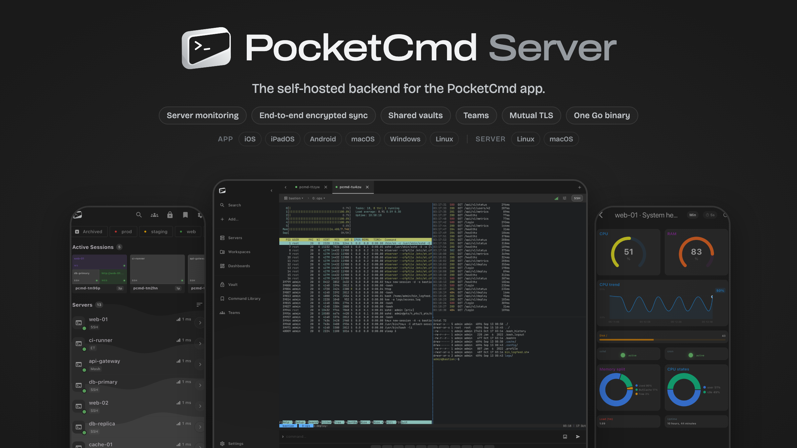

<div align="center">



PocketCmd Server is the self-hosted backend for the [PocketCmd](https://pocketcmd.com) mobile app.
It collects metrics using your custom commands, syncs your in-app vault with SSH configs, snippets and secrets end-to-end encrypted, and enables team features for managing and vault sharing.

One static Go binary, no cloud account, no reverse proxy, nobody in the middle. Your phone connects to it directly over mutual TLS.

**[Download](https://github.com/pocketcmd/pocketcmd-server/releases/latest)** · [Documentation](docs/) · [Report a bug](https://github.com/pocketcmd/pocketcmd-server/issues/new)

[](https://github.com/pocketcmd/pocketcmd-server/releases/latest)
[](https://github.com/pocketcmd/pocketcmd-server/actions/workflows/ci.yml)
[](LICENSE)
[](https://go.dev/dl/)

[Features](#features) · [Install](#install) · [Usage](#usage) · [Teams](#teams) · [Security](#security) · [Development](#development)

</div>

<a id="features"></a>

## Features

| Component | Capabilities |
| :--- | :--- |
| **Pairing** | Run `pcmd`, scan the QR code with the app, done. No passwords, API tokens or manual TLS setup. |
| **Device keys** | One ECDSA P-256 identity key per device, generated in the secure element where the hardware has one. |
| **Transport** | Mutual TLS with 30-minute client certificates and 5-minute channel-bound JWT sessions. |
| **Monitoring** | Command metrics your team proposes and the owner approves, alert rules, and time-series storage in SQLite. Nothing runs until you approve a command. |
| **Encrypted sync** | Tasks, SSH keys, snippets, secrets, workspaces, dashboards and settings sync as ciphertext the server cannot read. |
| **Shared vaults** | Share a vault with teammates. Removing a device or member rotates the vault key. |
| **Teams** | Multiple people with one or more devices each, admin and member roles, owner-gated privilege changes, invitation-based onboarding. |
| **Revocation** | Revoke a device or user and every live session dies on its next request. |
| **Service** | Installs itself as a systemd or launchd user service on first run and starts on boot. |
| **Push** | Alerts pushed directly from your self hosted server to reach the devices whose users allowed notifications in the app, through a stateless, zero-knowledge relay. |
| **One-shot sync** | Starts a short-lived server, syncs SSH configs to one device, and exits. |

<a id="install"></a>

## Install

The install script downloads the newest release, verifies its checksum, and puts `pcmd` on your `PATH`:

```bash
curl -fsSL https://pocketcmd.com/install.sh | sh
```

Run the same command again to update: it replaces `pcmd` where it is installed, restarts the running service, and puts the previous version back if the new one fails its health check. See [updating a server](docs/deployment.md#updating-a-server).

Pre-built binaries are also on the **[releases page](https://github.com/pocketcmd/pocketcmd-server/releases/latest)**:

| Platform | Architecture | Service |
| :--- | :--- | :--- |
| Linux | amd64 · arm64 | systemd user unit, or OpenRC |
| macOS | Apple Silicon · Intel | launchd agent |

Go users can build and install from the module directly:

```bash
go install github.com/pocketcmd/pocketcmd-server/cmd/pcmd@latest
```

Then, as the user who should own the server (shouldn't be root):

1. Run `pcmd`. It generates a server certificate, picks the network interface, and prints a QR code + URL.
2. Scan the code or paste the URL in the PocketCmd app to become the owner of the server.
3. The server installs itself as a background service. Add more devices and people with via the app or CLI with `pcmd invite`.

The QR code is refreshed every 60 seconds for up to 5 minutes. If no device pairs, nothing is saved and the next `pcmd` starts over.

<details>
<summary>Installation notes: networking, checksums and signatures</summary>

**Network interface.** The server listens on one interface and the QR code carries its address. Pick a different one, or every interface, with `--host`:

```bash
pcmd --host 10.8.0.1       # a VPN interface
pcmd --host 127.0.0.1      # loopback only (pair over an SSH tunnel)
pcmd --host 0.0.0.0        # every interface (:: for IPv6 too)
```

**Reaching it from outside your LAN.** On a VPS, pick the interface with the public IP and allow TCP 8767 in the firewall. Behind NAT, forward TCP 8767 to the server and put the public address in the QR code. Set it before pairing; it is saved and `pcmd invite` reuses it:

```bash
pcmd --advertise-ip myhome.example.net   # a dynamic-DNS name survives a changing home IP
```

**Verifying a download.** Releases ship `checksums.txt`, a keyless cosign signature of it, and SLSA build provenance:

```bash
sha256sum -c --ignore-missing checksums.txt
gh attestation verify pocketcmd_linux_amd64.tar.gz --repo pocketcmd/pocketcmd-server
```

The cosign command is in [docs/deployment.md](docs/deployment.md#verifying-a-release-by-hand). `go install` builds report version `1.0.0-dev`; only release-pipeline binaries carry the real version.

</details>

<a id="usage"></a>

## Usage

```bash
pcmd invite                # invite another device or team member (QR + code)
pcmd status                # service status, port, paired devices, data paths
pcmd list-devices          # active devices with key fingerprints (--all adds removed ones)
pcmd revoke-device <fp>    # revoke a device by fingerprint prefix
pcmd logs -f               # follow the structured log
pcmd audit                 # pairings, invites, role changes, approvals
pcmd backup backup.tar.gz  # snapshot config, certs and data
pcmd stop / start / restart
pcmd uninstall             # stop and remove the background service
```

Every command and flag is documented in the **[CLI reference](docs/cli-reference.md)**.

<details>
<summary>Configuration and data</summary>

`~/.pocketcmd/config.json` is written once a device has paired:

| Field | Values | Purpose |
| :--- | :--- | :--- |
| `service_mode` | `background` · `foreground` | Whether `pcmd` runs the service or stays in the foreground. |
| `port` | int | Listen port, default `8767`. `--port` overrides it per command. |
| `host` | IP | Bind address chosen on the first run. `--host` overrides it. |
| `advertise_ip` | IP or hostname | Address embedded in pairing, invite and sync URLs. Empty means the bind address. |
| `config_version` | int | Managed by the server. |

Everything else lives next to it: `state.db` (identity, devices, invites, monitoring config, encrypted sync records), `metrics.db` (time series), `audit.log`, and `tls/` (the server certificate). `pcmd backup` captures all of it. See [Files](docs/cli-reference.md#files).

</details>

<a id="teams"></a>

## Teams

The first device to pair becomes the **owner**: a role which alone can change roles, mint admin invitations, and grant the permissions. Everyone else joins through an invite.

```bash
pcmd invite --expires 48h --label "Alice's phone"   # a 48h member invite
pcmd invite --role admin --label "Bob (backup admin)"
pcmd invite --for alice                              # another device for an existing user
pcmd list-users                                      # members, roles, device counts
pcmd promote <user>  /  pcmd demote <user>           # owner only
pcmd revoke-user <user>                              # revoke a member's devices and invites
```

| Role | Capabilities |
| :--- | :--- |
| **owner** | Everything, plus the exclusive rights: change roles, create admin invitations, read the audit and log feeds. |
| **admin** | Manage member invitations, members and devices; export SSH configs; full metrics and sync. Approving host-command metrics needs the owner's grant. |
| **member** | Metrics and sync by default. Further capabilities are granted individually. |

Authorization is enforced on the server for every request. The app only hides what it knows will be denied. The full team workflow, including grants, vault membership and metric-command approvals, is in the [CLI reference](docs/cli-reference.md#team-commands) and the [API reference](docs/api.md#team).

<a id="security"></a>

## Security

- **Identity:** authorization is anchored on per-device public keys in a server-side registry, re-checked on every request. Where the device has a secure element (Secure Enclave, StrongBox/TEE, TPM 2.0) the key never leaves it; otherwise it is a software key sealed in platform secure storage.
- **Transport:** TLS 1.3 only. Clients pin the server's certificate fingerprint at QR-scan time. Client certificates live 30 minutes, JWT sessions 5 minutes, and the JWT signing key is derived separately from the certificate-issuing key.
- **Sync:** the server stores opaque AES-256-GCM blobs encrypted on the device under per-vault keys. It cannot decrypt them.
- **Two deliberate carve-outs:** monitoring commands are plaintext to the server, because its scheduler executes them, and the server sees sync metadata (record types, counts, sizes, timestamps, device IDs).
- **Host commands** need a permission only the owner holds by role and only the owner can grant, enforced at two choke points.

The full model, the threat model, the deliberate trade-offs, and **how to report a vulnerability** are in **[SECURITY.md](SECURITY.md)**.

<a id="development"></a>

## Development

Written in **Go 1.26+** with no runtime dependencies.

```bash
git clone https://github.com/pocketcmd/pocketcmd-server.git
cd pocketcmd-server
make build          # build for the current platform
make test           # run the test suite
make test-docker    # cross-platform E2E tests (requires Docker)
make all            # cross-compile every target
```

[Contributing](CONTRIBUTING.md) · [Architecture](docs/architecture.md) · [API reference](docs/api.md) · [CLI reference](docs/cli-reference.md) · [Deployment](docs/deployment.md) · [Issues](https://github.com/pocketcmd/pocketcmd-server/issues)

## License

[MIT](LICENSE)
